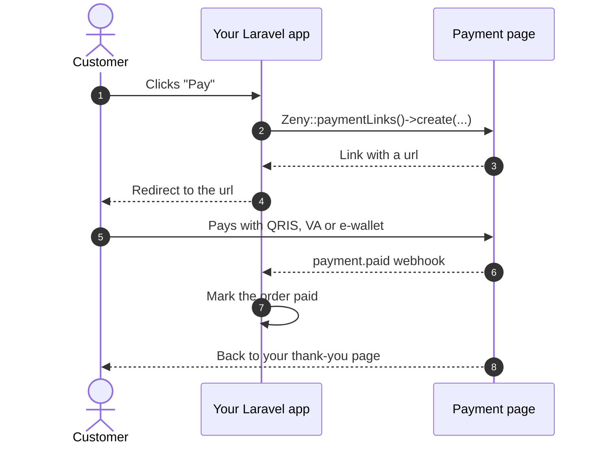

<div align="center">

# usezeny/laravel

**Take payments in your Laravel app in minutes.**
Payment links, QRIS, virtual accounts and e-wallets, with one `composer require`.

[](https://github.com/Zeny-Pay/zeny-laravel-sdk/actions/workflows/ci.yml)


[](LICENSE)

[Get started](#get-started-in-3-steps) · [See it work](#how-a-payment-flows) · [Full guide](GUIDE.md) · [Changelog](CHANGELOG.md)

</div>

---

## Why you'll like it

| | |
|---|---|
| 🔗 **Payment links in one call** | Create a hosted checkout page and send your customer there. No checkout UI to build. |
| 🇮🇩 **Every way Indonesia pays** | QRIS, bank virtual accounts (BCA and more) and e-wallets such as GoPay, all from the same link. |
| 🛡️ **Never charges twice** | Network hiccups are retried for you, and every retry is the same request, so a customer is never charged twice. |
| 🔔 **Know the moment you're paid** | Webhooks arrive signed and checked. One middleware, and your route gets a ready-to-use event. |
| 🧪 **Sandbox first** | A test key gives you a full playground with fake money. Switch to a live key when you're ready. Nothing else changes. |
| 🎯 **Feels like Laravel** | Auto-discovered service provider, a `Zeny` facade, `.env` config and a mockable interface for your tests. |

## Get started in 3 steps

**1. Install**

```bash
composer require usezeny/laravel
```

**2. Add your keys to `.env`**

```dotenv
ZENY_SECRET_KEY=sk_test_...      # from the dashboard, Developers page
ZENY_WEBHOOK_SECRET=whsec_...    # from your webhook endpoint
```

A `sk_test_` key works in Sandbox, where no real money moves.

**3. Create a payment link and send your customer to it**

```php
use App\Models\Order;
use Illuminate\Http\RedirectResponse;
use Illuminate\Support\Facades\Route;
use Zeny\Domain\RequestOptions;
use Zeny\Laravel\Facades\Zeny;

Route::post('/orders/{order}/pay', function (Order $order): RedirectResponse {
    $link = Zeny::paymentLinks()->create([
        'name' => "Order #{$order->id}",
        'amount' => ['value' => $order->total, 'currency' => 'IDR'], // a decimal string, never a float
        'successRedirectUrl' => route('orders.thanks', $order),
        'maxPayments' => 1, // one order, one payment: the link closes once paid
        'requiredPayerFields' => ['email'], // the payer must give an email for the receipt
    ], new RequestOptions(idempotencyKey: "order-{$order->id}-link"))->toArray();

    $order->update(['payment_link' => $link['id']]); // pl_..., matched on the payment.paid webhook

    return redirect()->away($link['url']); // the hosted checkout page
});
```

That's it. Your customer pays on the hosted page and comes back to your thank-you page.

## How a payment flows



> 💡 **Golden rule:** mark an order paid only when the `payment.paid` webhook arrives, never just because the customer came back to your site.

## Know when you're paid

Add the `zeny.webhook` middleware to a route. It checks every webhook's signature, and your code only sees real events:

```php
use App\Models\Order;
use Illuminate\Foundation\Http\Middleware\ValidateCsrfToken;
use Illuminate\Http\Request;
use Illuminate\Http\Response;
use Illuminate\Support\Facades\DB;
use Illuminate\Support\Facades\Route;
use Zeny\Laravel\Middleware\VerifyZenyWebhook;

Route::post('/webhooks/payments', function (Request $request): Response {
    $event = VerifyZenyWebhook::event($request); // checked by the zeny.webhook middleware

    DB::transaction(function () use ($event): void {
        // A unique key on id: a repeated event inserts nothing and changes nothing.
        $isNew = DB::table('webhook_events')->insertOrIgnore(['id' => $event['id'], 'type' => $event['type']]) === 1;
        if (! $isNew || $event['type'] !== 'payment.paid') {
            return;
        }
        $payment = $event['data']['object'];
        // A link payment carries its pl_ id; an API payment carries your reference.
        if ($payment['paymentLink'] !== '') {
            Order::markPaidByLink($payment['paymentLink']);
        } else {
            Order::markPaid($payment['reference']);
        }
    });

    // 204 only after the commit. An exception answers 500, so the event comes again.
    return response()->noContent();
})->middleware('zeny.webhook')->withoutMiddleware(ValidateCsrfToken::class);
```

Webhooks can arrive twice, so the route saves each event once by its id and ignores repeats.

## What you can do

| | |
|---|---|
| **Payment links** | Create, list, close, reopen and cancel hosted checkout links. Limit how many times a link can be paid, and ask for the payer's name, email or phone. |
| **Payments** | Build your own checkout: create a payment, then show the customer a QR code, a virtual account number or an e-wallet redirect. |
| **Payouts** | Send money out to a bank account, and cancel a payout before it goes out. |
| **Disputes** | See the disputes raised on your payments. |
| **Sandbox test funds** | Top up your Sandbox balance to try payouts. |

Every option and edge case is in the **[Guide](GUIDE.md)**:

- [Payment links in detail](GUIDE.md#payment-links-in-detail)
- [Custom checkout](GUIDE.md#custom-checkout)
- [Laravel setup and config](GUIDE.md#laravel-setup)
- [Webhooks without Laravel](GUIDE.md#webhooks)
- [Handling errors](GUIDE.md#errors)
- [Safe retries](GUIDE.md#idempotency-and-retries)
- [Sandbox, Production and white-label hosts](GUIDE.md#environments-and-baseurl)

## Built to be safe

- **Your secret key stays secret.** It never shows up in error messages, logs or `dd()` dumps.
- **Money is exact.** Amounts are strings like `'150000'`, never floats that round wrong.
- **No double charges.** Retries reuse the same idempotency key, so the payment happens once.
- **Webhooks fail closed.** A webhook with a bad or old signature is rejected before your code runs.
- **Typed end to end.** PHPStan knows every field of every response, and the types come straight from the API contract.

## Requirements

| PHP | Laravel |
|---|---|
| 8.2+ | 12 |
| 8.3+ | 12 or 13 |

Outside Laravel, the client works in any PHP 8.2+ project. See the [Guide](GUIDE.md#environments-and-baseurl).

## Contributing

Issues and pull requests are welcome. [AGENTS.md](AGENTS.md) has the architecture, the commands and the rules every change follows, and [RELEASING.md](RELEASING.md) explains how a version ships.

## License

MIT. See [LICENSE](LICENSE).
